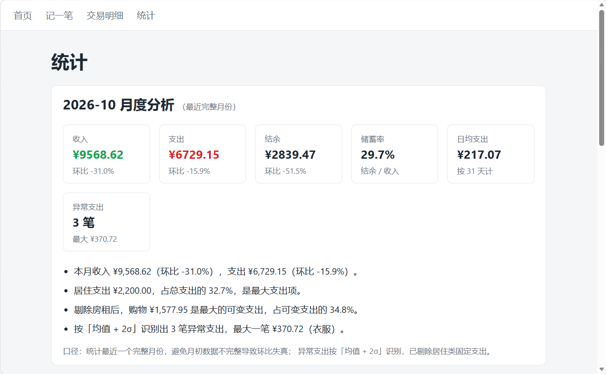

# 个人记账与支出分析应用

基于 **Flask + SQLite** 的个人记账 Web 应用。除了记录收支，统计页会用 SQL 计算**环比、储蓄率、分类占比和异常支出**，并自动生成中文分析结论。纯服务端渲染，图表使用内联 SVG，无前端框架、无 CDN 依赖。

**在线演示**：https://zhangxx.pythonanywhere.com
演示数据由 `seed_demo.py` 生成，不是真实个人数据。



## 项目要回答的问题

1. 这个月的钱花在哪了？
2. 和上个月相比，收入、支出、结余变化多少？
3. 储蓄率是否健康？
4. 哪些支出明显偏离日常水平？

## 数据说明

| 项目 | 说明 |
|---|---|
| 演示数据 | 最近 12 个月，约 700 条模拟交易 |
| 生成方式 | `seed_demo.py`，固定随机种子 42，可复现 |
| 真实数据 | 通过网页表单录入，保存在 `expense.db` |
| 数据隔离 | 演示数据在 `demo.db`，与真实数据互不影响 |

> README 中的数字来自 2026-11-04 生成的演示数据；重新生成时日期范围会随当前日期滚动，具体数字可能略有不同。

## 分析方法

### 1. 统计口径：最近完整月份

统计页默认展示**最近一个已经结束的月份**，而不是当前月。

原因：月初当月只有几天数据。如果拿 4 天的数据去和上月整月做环比，会得出"支出暴跌 80%"之类的假结论。把当月未完整数据排除在环比之外，是避免口径错误的基本处理。

### 2. 环比：CTE + 窗口函数

用 SQL 的 `WITH` 和 `LAG()` 取上一个月的值：

```sql
WITH months(month) AS (VALUES (?), (?)),
monthly AS (
    SELECT m.month,
           COALESCE(SUM(CASE WHEN t.type = 'income'  THEN t.amount END), 0) AS income,
           COALESCE(SUM(CASE WHEN t.type = 'expense' THEN t.amount END), 0) AS expense
    FROM months m
    LEFT JOIN transactions t ON substr(t.date, 1, 7) = m.month
    GROUP BY m.month
),
with_prev AS (
    SELECT month, income, expense,
           LAG(income)  OVER (ORDER BY month) AS prev_income,
           LAG(expense) OVER (ORDER BY month) AS prev_expense
    FROM monthly
)
SELECT * FROM with_prev WHERE month = ?
```

- `months` CTE 显式生成上月和本月两行，避免"上月没有记录"时整行丢失
- `LEFT JOIN` + `COALESCE` 保证空月份按 0 处理
- `LAG()` 取上一行的值，作为环比的分母

环比定义：`(本月 - 上月) / 上月 × 100%`；上月为 0 时显示"无上月数据"。

### 3. 储蓄率与日均支出

- **储蓄率** = (收入 - 支出) / 收入 × 100%
- **日均支出** = 当月支出 / 当月天数

### 4. 异常支出：均值 + 2σ

对当月每笔支出计算均值和标准差，把超过 `均值 + 2σ` 的记录视为异常。

两个处理细节：

- **剔除居住类固定支出**：房租每月固定，金额天然远高于日常消费，不剔除会让阈值失真
- **样本少于 3 笔时不做判断**，避免小样本下阈值不可靠

本期阈值约为 ¥253，识别出 3 笔异常支出。

## 关键发现（2026-10 演示数据）

| 指标 | 数值 |
|---|---|
| 收入 | ¥9,568.62 |
| 支出 | ¥6,729.15 |
| 结余 | ¥2,839.47 |
| 储蓄率 | 29.7% |
| 日均支出 | ¥217.07 |
| 收入环比 | -31.0% |
| 支出环比 | -15.9% |
| 异常支出 | 3 笔 |

1. **收入环比下降 31%，主要来自一次性因素**：9 月包含季度奖金 ¥4,824.81，10 月没有。剔除奖金后，两个月工资分别为 ¥9,035.75 和 ¥9,568.62，量级接近。这提醒我：看到环比大幅波动时，要先拆解一次性项目。
2. **支出环比下降 15.9%**，结余 ¥2,839.47，储蓄率 29.7%。
3. **房租是最大支出项**：居住 ¥2,200，占总支出的 32.7%。剔除房租后，购物 ¥1,577.95 是最大的可变支出，占可变支出的 34.8%。
4. **识别出 3 笔异常支出**，最大一笔 ¥370.72（衣服），阈值约 ¥253。

## 功能

- 记录收入/支出：金额、分类、日期、备注
- 首页本月概览：收入 / 支出 / 结余
- 交易明细：按月份、类型、分类筛选，实时合计
- 编辑 / 删除记录
- 统计页：
  - 月度分析：环比、储蓄率、日均支出、异常支出
  - 支出 / 收入分类条形图与占比环形图
  - 近 6 个完整月收支趋势
- 服务端表单校验
- `--demo` 演示模式，与真实账本隔离

## 技术栈

| 层 | 技术 |
|---|---|
| 语言 | Python 3 |
| Web 框架 | Flask |
| 数据库 | SQLite（标准库 `sqlite3`） |
| 模板 | Jinja2 |
| 样式 | 原生 CSS |
| 图表 | 服务端渲染内联 SVG（无 JS 图表库） |
| SQL | CTE、窗口函数（`LAG`）、条件聚合 |

## 项目结构

```text
expense-tracker/
├── app.py                 # 路由、校验、分析指标
├── db.py                  # 数据库连接、建表、预置分类
├── seed_demo.py           # 生成 12 个月演示数据 -> demo.db
├── requirements.txt
├── docs/
│   └── analysis.png       # 统计页截图
├── static/
│   └── style.css
└── templates/
    ├── base.html
    ├── index.html
    ├── add.html
    ├── list.html
    ├── edit.html
    └── stats.html
```

## 快速开始

```bash
# 1. 安装依赖
pip install -r requirements.txt

# 2. 生成演示数据（约 700 条，写入 demo.db）
python seed_demo.py

# 3. 以演示模式启动
python app.py --demo

# 浏览器打开 http://127.0.0.1:5000
```

如果你要记录自己的账，直接运行 `python app.py`，数据会写入 `expense.db`。

## 指标口径

| 指标 | 定义 |
|---|---|
| 环比 | (本月 - 上月) / 上月 × 100%；上月为 0 显示"无上月数据" |
| 储蓄率 | (收入 - 支出) / 收入 × 100% |
| 日均支出 | 当月支出 / 当月天数 |
| 异常支出 | 金额 > 均值 + 2σ；剔除居住类固定支出，样本少于 3 笔不判断 |

## 局限与下一步

- 演示数据为模拟生成，仅用于展示分析方法，不代表真实消费习惯
- 单用户应用，无登录与权限
- 当前只做描述性统计，不做预测
- 分类体系固定，暂不支持自定义分类
- 下一步：月份选择器、预算 vs 实际、CSV 导出、周末/工作日支出对比

## 设计取舍：为什么做成 Web

记账需要日常采集入口，分析结果也要给非技术用户看。Notebook 适合离线探索，但不适合每天录入；Web 应用可以把"采集 → 存储 → 分析 → 展示"放在同一条链路里。本项目刻意不引入前端框架和 JS 图表库，图表由 Python 生成内联 SVG，部署简单、依赖少。
